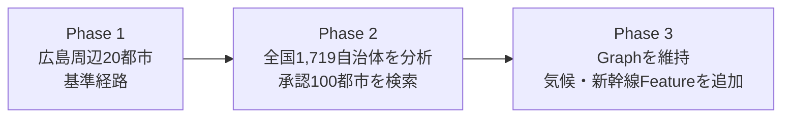
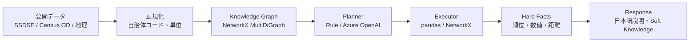

# Pythonで構築する人口移動ナレッジグラフ：NetworkXとGraphRAGによる意味的地域検索

このリポジトリは、[PyCon JP 2026の発表「Pythonで構築する人口移動ナレッジグラフ：NetworkXとGraphRAGによる意味的地域検索」](https://2026.pycon.jp/ja/talks/DXCNYY)で使用する公開リポジトリです。
発表タイトルにGraphRAGが含まれていますが、現在のPhase 1〜3の標準実行経路は、
公開構造化データ、pandas、NetworkX、Azure OpenAIのPlanner/Responseで構成し、
GraphRAG/Wikipedia/Embedding検索は使用していません。

この`pyconjp2026-municipal-mobility-graph/`ディレクトリがGitHubで管理する
公開リポジトリルートです。
GitHubから開いた利用者は、まずこのREADMEを読み、追試するフェーズのディレクトリへ
移動してください。

| ディレクトリ | 位置づけ | 利用者が行うこと |
|---|---|---|
| [`phase1/`](phase1/) | Phase 1の完結した基準状態 | 20都市の追試・Acceptance |
| [`phase2/`](phase2/) | 全国主要100都市へ拡張したPhase 2 | 全国分析・地域検索・複合条件の追試 |
| [`phase3/`](phase3/) | Phase 3の完結した生活環境データ拡張 | 気候・新幹線・未収録条件境界の追試 |
| [`visualizer/`](visualizer/) | Phase 1〜3を横断するローカル監査UI | Phase Evolution、Graph、同一Query比較、Node Inspector |
| ルート直下の`README.md`、`LICENSE`、`.gitignore` | GitHubリポジトリの案内・共通管理 | フェーズ選択と運用ルールを確認する |

## 目次

- [Phaseの成長](#phaseの成長)
- [データから回答までの構成](#データから回答までの構成)
- [公開リポジトリを取得して再現する](#公開リポジトリを取得して再現する)
- [クイックスタート](#クイックスタート)
- [各PhaseでLLM Queryを試す](#各phaseでllm-queryを試す)
- [Phase間の同一Query比較](#phase間の同一query比較)
- [Phase 1〜3のローカル可視化UI](#phase-1〜3のローカル可視化ui)
- [自然言語でできること](#自然言語でできること)
- [データから回答まで](#データから回答まで)
- [データソースとライセンス](#データソースとライセンス)
- [主な生成物](#主な生成物)
- [検証](#検証)
- [重要な制限](#重要な制限)
- [Phase 2](#phase-2)
- [Phase 3](#phase-3)
- [ライセンス](#ライセンス)

ルート直下にはフェーズ固有の実行コードを置きません。各フェーズは前フェーズのコピーを
独立実行単位として保持しています。フェーズ間の差分を確認するときは、比較対象の
ディレクトリだけを実行し、完了済みの前フェーズを変更しません。

Phase 2の実装・検証状態は
[実装・検証報告書](phase2/docs/phase2_implementation_report.html)で確認できます。
Phase 1の実装・検証状態は
[実装報告書](phase1/docs/phase1_implementation_report.html)で確認できます。
Phase 3の実装・検証状態は
[実装・検証報告書](phase3/docs/phase3_implementation_report.html)、Phase 1〜3全体の
監査結果は[横断監査報告書](phase3/docs/cross_phase_audit.html)で確認できます。

## Phaseの成長



Phase 1→2は探索空間・分析空間・ODネットワークの拡張、Phase 2→3はGraphを壊さない
Feature Store拡張です。

## データから回答までの構成



LLMは意図解釈と説明に限定し、ランキングや数値はStructured DataとPython計算から生成します。

## 公開リポジトリを取得して再現する

```bash
git clone https://github.com/negi111111/pyconjp2026-municipal-mobility-graph.git
cd pyconjp2026-municipal-mobility-graph
```

Phase 1〜3は独立ディレクトリとして管理しています。各Phaseの`README.md`と
`make help`が、そのPhaseだけを再現する入口です。raw公開データは各Phaseの
download scriptから取得し、取得時刻・サイズ・SHA-256をprovenance manifestへ記録します。
`.env`はGit管理せず、必要な場合だけローカルに作成してください。

公的な都市統計、通勤・通学OD、空港・地理データを構造化し、pandas / NetworkXで計算した結果を日本語で探索できるOSSです。ランキングや数値はLLMに計算させず、必ず処理済みデータと分析関数から生成します。

Phase 1の対象は次の固定20都市です。

- 広島県：広島市、呉市、東広島市、廿日市市、大竹市、三原市、尾道市、福山市、安芸高田市
- 山口県：岩国市、周南市、山口市
- 岡山県：岡山市、倉敷市、笠岡市
- 島根県：松江市、浜田市
- 愛媛県：松山市、今治市
- 香川県：高松市

正式なIDと順序は [phase1/configs/phase1_cities.yml](phase1/configs/phase1_cities.yml) が正です。ODによる入れ替え候補は別レポートに出力し、このseedを自動変更しません。

## クイックスタート

コアに必要なものはPython 3.10以上、[uv](https://docs.astral.sh/uv/)、データ取得時の
インターネット接続です。Azure OpenAIのLLM経路を使う場合だけ、ルートの`.env`または
環境変数に接続設定が必要です。設定項目のテンプレートはルートの[.env.example](.env.example)
を参照し、`.env`をPhase内へコピーしません。

リポジトリをcloneした後、追試するフェーズへ移動して実行します。以下はPhase 1の例です。

~~~bash
cd phase1
uv sync --extra dev --no-install-project
PYTHONPATH=. uv run --no-sync python scripts/download_data.py
PYTHONPATH=. uv run --no-sync python pipeline/06_prepare_phase1.py
PYTHONPATH=. uv run --no-sync python -m app.query --query "広島市と一番人の行き来が多い都市は？"
uv run --no-sync pytest -q
~~~

makeを使う場合も同じ手順です。

~~~bash
cd phase1
make install
make download
make prepare
make query Q="広島市と一番人の行き来が多い都市は？"
make acceptance
~~~

JSONのStructured Evidenceが必要な場合は <code>--json</code> を付けます。

~~~bash
cd phase1
PYTHONPATH=. uv run --no-sync python -m app.query --query "広島市と似ていて空港も近い都市は？" --json
~~~

Azure OpenAIをQuery Plannerと回答説明に接続する場合は <code>--llm</code> を付けます。
接続設定は既存の <code>.env</code> または環境変数から読み込みます。APIキーはログや
Structured Evidenceへ出力しません。LLMは意図理解・説明だけを担当し、ランキング、
距離、類似度、統計値はローカルのpandas / NetworkXが計算します。

~~~bash
cd phase1
PYTHONPATH=. uv run --no-sync python -m app.query --llm --query "広島市と一番人の行き来が多い都市は？"
make acceptance-llm
~~~

全コマンドは各フェーズ内の <code>make help</code>、個別の引数は <code>--help</code> で確認できます。取得済みファイルは再利用され、実際のURL、取得時刻、バイト数、SHA-256は [phase1/data/provenance/download_manifest.json](phase1/data/provenance/download_manifest.json) に書き出されます。

## 各PhaseでLLM Queryを試す

3つのPhaseで共通して、Phaseディレクトリへ移動して
`make query-llm Q="日本語の質問"`を実行できます。接続設定はリポジトリルートの
`.env`（または環境変数）から読み込み、`.env`をPhase内へコピーする必要はありません。
初回だけ各Phaseで依存とprocessed dataを準備してください。

### Phase 1：20都市

```bash
cd phase1
make install
make download
make prepare
make query-llm Q="広島市と一番人の行き来が多い都市は？"
```

JSONで取得する場合は`make query-llm-json Q="広島市と似ていて空港アクセスも良い都市は？"`、
全7問の接続確認は`make acceptance-llm`です。

### Phase 2：全国100都市

```bash
cd phase2
make install
make prepare-phase2
make query-llm Q="福岡市に都市特性が似ていて空港アクセスも良い都市は？"
```

JSONで取得する場合は`make query-llm-json Q="全国主要都市で人流ハブ性が高い都市は？"`、
全10問の接続確認は`make acceptance-llm`です。

### Phase 3：気候・新幹線付き100都市

```bash
cd phase3
make install
make prepare-phase3
make query-llm Q="福岡市に似ていて冬が比較的暖かい都市は？"
```

JSONで取得する場合は`make query-llm-json Q="空港と新幹線の両方へのアクセスが良い都市は？"`、
全6問の接続確認は`make acceptance-phase3-llm`です。

LLM経路でも数値・順位・距離・類似度は各Phaseのpandas / NetworkXが計算し、
LLMは意図解釈と説明だけを担当します。APIキーはログやStructured Evidenceへ出力しません。
Azure OpenAIのChat Deploymentは`AZURE_OPENAI_CHAT_DEPLOYMENT`で指定し、
比較考察の`AZURE_OPENAI_REASONING_EFFORT`既定値は`xhigh`です。通常Queryは
Planner=`high` / Response=`medium` / 各4096 tokenに分け、比較考察だけ8192 tokenの
xhighを使うため、通常応答を高速化しています。役割別環境変数で上書きできます。

## Phase間の同一Query比較

Phase 3ディレクトリから、同じQueryをPhase 1〜3へ渡して各Phaseの回答と差分を確認できます。

```bash
cd phase3
make compare-phases Q="広島市と都市特性が似ている都市は？"
```

各PhaseのLLM経路を通し、3Phaseの回答結果自体をxhighのLLMに考察させる場合：

```bash
make compare-phases-llm Q="広島市と都市特性が似ている都市は？"
```

各Phaseの日本語回答・Structured Result・機械的差分・LLM考察は、
既定で`/tmp/pyconjp2026-mobility-kg-phase-comparison/`に
`comparison.md`と`comparison.json`として保存されます。

## Phase 1〜3のローカル可視化UI

既存のGraph、Feature Store、Query結果を変更せずに確認するStreamlit UIを
[visualizer/](visualizer/)へ追加しています。APIキーなしでPhase Evolution、
Graph Explorer、offline Query Comparison、Node Inspector、coverageを確認できます。

```bash
cd visualizer
make install
make run
```

詳細は[visualizer/README.md](visualizer/README.md)を参照してください。
リポジトリルートから起動する場合は、次の短縮コマンドも使用できます。

```bash
make install
make run
```

## 自然言語でできること

Phase 1は次の7系統を受け付けます。すべての数値はクエリ解析後にpandas / NetworkXが計算します。

| 質問例 | 実行する分析 |
|---|---|
| 広島市と人の行き来が最も多い都市は？ | 通勤・通学の A→B + B→A |
| 広島周辺で人流のハブになっている都市は？ | weighted in/out/total degree、weighted PageRank |
| 県境をまたぐ実質的な生活圏はある？ | 人流投影上のLouvain community |
| 広島市と都市特性が似ている都市は？ | SSDSE特徴量のcosine類似度 |
| 広島市より空港アクセスが良い都市は？ | 最寄り定期便空港までの直線距離で比較 |
| 広島市と似ていて空港アクセスも良い都市は？ | 空港距離でfilter後、SSDSE類似度で順位付け |
| 医療面で広島市と似ている都市は？ | 医療カテゴリのSSDSE類似度 |

例えば「自然が豊かで温泉もあって空港が近い都市は？」と聞くと、空港は実データで評価し、自然・温泉は「現在の構造化データにない条件」として分離します。LLMの一般知識で欠損を埋めたり、固定の <code>livability_score</code> を作ったりしません。

## データから回答まで

~~~text
公的データの固定版を取得
  → 20都市に正規化
  → NetworkX MultiDiGraph
  → pandas / NetworkXの名前付き分析関数
  → Structured Evidence
  → 根拠と計算式を付けた日本語回答
~~~

グラフのノードは <code>Prefecture</code> / <code>Municipality</code> / <code>Airport</code>、リレーションは <code>IS_IN</code> / <code>COMMUTES_TO</code> / <code>STUDIES_IN</code> / <code>ACCESS_TO</code> です。人流PageRank、degree、community検出に使うのは <code>COMMUTES_TO</code> と <code>STUDIES_IN</code> だけで、行政関係や空港アクセスを混ぜません。

都市類似度は [phase1/configs/similarity_features.yml](phase1/configs/similarity_features.yml) の28特徴量を使います。全体のほか、人口・世帯、医療、教育、経済・労働、福祉を別々に比較できます。設定済みの比率化・対数変換を行い、欠損は中央値、その後にPhase 1比較集合でz標準化してcosine類似度を計算します。実際の変換と補完数は回答JSONに残ります。

空港の「近さ」は、P05-22の市役所代表点からC28-21の定期便対象空港参照点までのHaversine直線距離です。旅客数に基づく空港規模は別属性です。executorは明示的な距離・規模スコアも返せますが、「近い」という条件を規模で置き換えません。

設計と数式の詳細は [phase1/docs/phase1_design.md](phase1/docs/phase1_design.md) を参照してください。

### LLMとの境界

標準CLIは、クリーンな環境で同じacceptanceを再現するため、日本語の決定的なオフラインplannerを使います。<code>--llm</code> を付けるとAzure OpenAIのchat completionsをPlanner/Responseに接続します。<code>PlannerProvider</code> と <code>ResponseProvider</code> はLLM adapter用の明示的な境界です。LLMを接続してもplannerが返せるのは検証済みのintent・都市・条件だけで、responseの補足は <code>hard_facts</code> の外側に保存されます。数値、順位、統計値、グラフのfactをLLMから受け取るインターフェースはありません。

## データソースとライセンス

Phase 1の取得元はすべて公的機関です。下表のライセンス名は概要であり、正式なURL、引用文、再配布条件、変換内容は [phase1/data/provenance/sources.yml](phase1/data/provenance/sources.yml) と [phase1/data/provenance/LICENSE_DATA.md](phase1/data/provenance/LICENSE_DATA.md) が正です。

| データ | 版 | 用途 | 配布元 / 条件の概要 |
|---|---|---|---|
| SSDSE-A | 2026 | 市区町村の属性 | 統計センター / 政府標準利用規約2.0準拠、CC BY 4.0互換 |
| 2020年国勢調査 Table 3 | 2020 | 常住地→従業地・通学地OD | 総務省統計局 / e-Stat利用規約、CC BY 4.0互換 |
| 国土数値情報 P05-22 | 2022年4月時点 | 市役所の代表点 | 国土交通省 / 公共データ利用規約1.0 |
| 国土数値情報 C28-21 | 2021年12月31日時点 | 空港ノード・参照点 | 国土交通省 / 旧利用約款、商用利用可 |
| 空港管理状況調書 | 2025 | 年間旅客数と空港規模 | 国土交通省航空局 / 公共データ利用規約1.0 |

データはコードのMIT Licenseで再許諾されません。raw / processedを再配布するときは、引用、加工表示、制限事項、provenanceファイルを一緒に保持してください。

## 主な生成物

Phase 1の<code>pipeline/06_prepare_phase1.py</code> は品質チェックを通過したときだけ、主要テーブルとグラフを <code>phase1/data/processed/</code> に出力します。

- <code>municipalities.parquet</code>：20都市の代表点、SSDSE属性、比較特徴量
- <code>commute_edges.parquet</code> / <code>study_edges.parquet</code> / <code>flow_edges.parquet</code>：2020年の有向OD
- <code>airports.parquet</code> / <code>airport_access.parquet</code>：定期便空港と最寄り距離
- <code>knowledge_graph.json</code>：MultiDiGraphのnode-link JSON
- <code>phase1_analysis.json</code>：基本分析の再現用snapshot
- <code>quality_report.json</code>：件数、主キー、OD整合、県境OD、空港結合、グラフ層のgate
- <code>processing_report.json</code>：パイプラインと出力件数
- <code>seed_membership_review.csv</code>：seed外の候補と人流根拠。seedの自動変更には使わない

全ファイルのgrainと現在のsnapshot件数は [phase1/data/README.md](phase1/data/README.md) にまとめています。

Phase 1の可視化は次のコマンドで再生成します。出力は外部フォントやJavaScriptに依存しないSVGです。

~~~bash
cd phase1
make visualize
~~~

- [phase1/docs/figures/administrative_membership.svg](phase1/docs/figures/administrative_membership.svg)
- [phase1/docs/figures/top_intercity_flows.svg](phase1/docs/figures/top_intercity_flows.svg)
- [phase1/docs/figures/mobility_nearest_airport.svg](phase1/docs/figures/mobility_nearest_airport.svg)
- [phase1/docs/figures/bidirectional_flow_ranking.svg](phase1/docs/figures/bidirectional_flow_ranking.svg)

## 検証

~~~bash
cd phase1
make test
make lint
make acceptance
~~~

<code>make acceptance</code> は取得→整形→4つのSVG再生成→テストの後、7系統の質問を実データに対して検証し、[phase1/docs/phase1_acceptance.html](phase1/docs/phase1_acceptance.html) と <code>phase1/data/processed/acceptance_results.json</code> を再生成します。HTMLレポートは外部CSSやJavaScriptに依存しない自己完結型です。

同梱snapshotの [phase1/data/processed/quality_report.json](phase1/data/processed/quality_report.json) は、20都市、空港アクセス20件、県境OD保持、relation分離を含む15チェックが <code>pass</code> です。環境や入力版を変えたときは、同梱snapshotではなく再実行結果を判定に使ってください。

## 重要な制限

- 人流グラフは固定20都市の誘導部分グラフです。「最大」、中心性、communityは日本全国ではなく、この20都市の中だけの結果です。
- 国勢調査の自都市ODは、市内活動に加えて従業地・通学地不詳や海外を含み得るため、都市間edgeから除外しています。
- 最寄り空港距離は市役所→空港参照点の直線距離であり、道路・鉄道・旅客ターミナルまでの所要時間ではありません。
- 市役所座標は2022年、空港形状は2021年、旅客数は2025年と参照時点が異なります。現在の旅客数結合率は86/87で、福岡空港（奈多地区）は未結合です。
- SSDSEの項目ごとに参照年が異なります。類似度の標準化と順位は20都市の構成に依存します。
- 家賃、気候、自然、森林、温泉、災害リスク、鉄道所要時間、空港便数、観光はPhase 1のデータにありません。
- 10入力のSHA-256は2026-08-21にレビューしてコードへ固定しています。取得済みファイルも再取得ファイルも一致しなければ処理を停止します。配布元の改版を採用するときは、digestだけを機械的に差し替えず、出典・ライセンス・schema・分析への影響を再レビューしてください。

## Phase 2

全国主要100都市への機能実装は完了しています。Phase 2は全国1,719自治体を分析空間、
承認済み100都市を検索空間として分離します。候補選定、全国OD、全国中心性、地域フィルタ、
複合条件検索、10問Acceptanceの詳細は[phase2/README.md](phase2/README.md)、
[phase2/docs/phase2_acceptance.html](phase2/docs/phase2_acceptance.html)、
[phase2/docs/phase2_implementation_report.html](phase2/docs/phase2_implementation_report.html)を
参照してください。性能・メモリの実測はPhase 3の
[横断監査報告書](phase3/docs/cross_phase_audit.html)に記録しています。

## Phase 3

Phase 3はPhase 2をコピーした独立実行単位で、承認済み100都市へ気候と新幹線アクセスを
追加しています。JMA 1991-2020年平年値、MLIT N02-20最近傍新幹線駅距離、住居費・災害・
自然の未採用条件境界、6問Acceptanceの詳細は[phase3/README.md](phase3/README.md)、
[phase3/docs/phase3_acceptance.html](phase3/docs/phase3_acceptance.html)、
[phase3/docs/phase3_implementation_report.html](phase3/docs/phase3_implementation_report.html)を
参照してください。

## ライセンス

コードは [MIT License](LICENSE) です。データはそれぞれの配布元の条件に従います。
